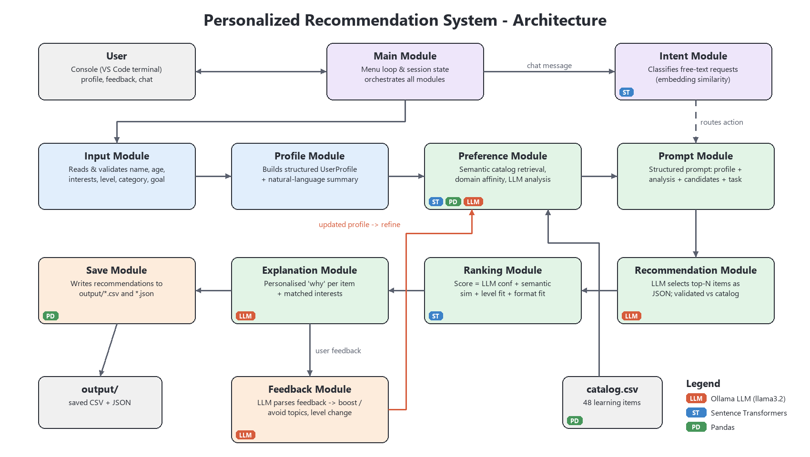
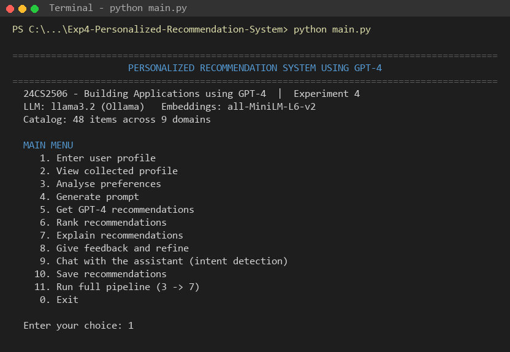
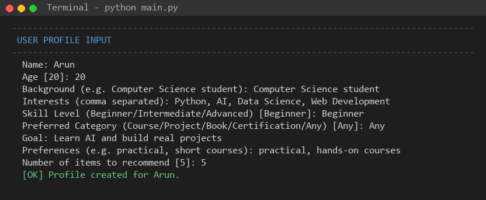
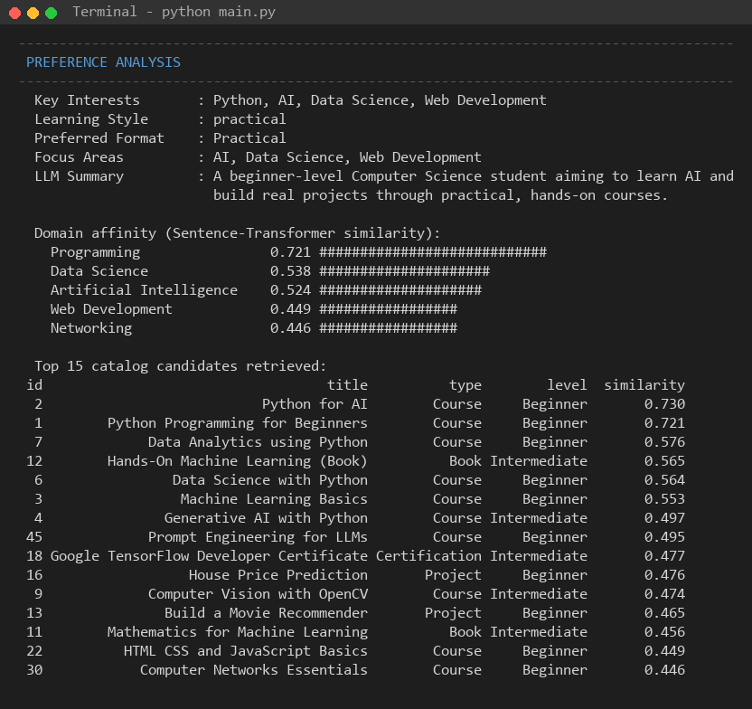
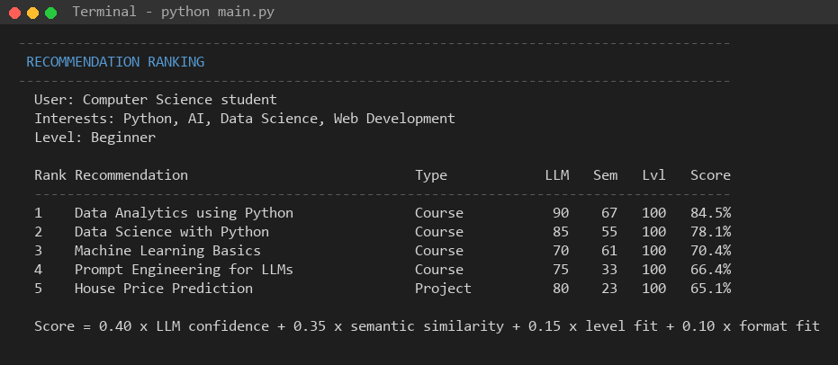
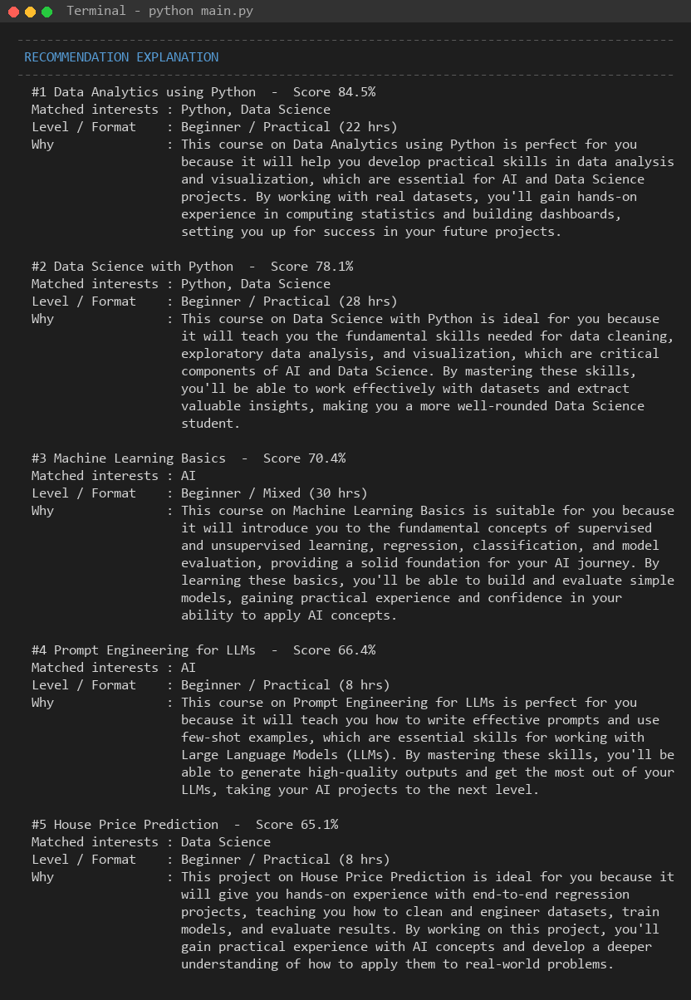
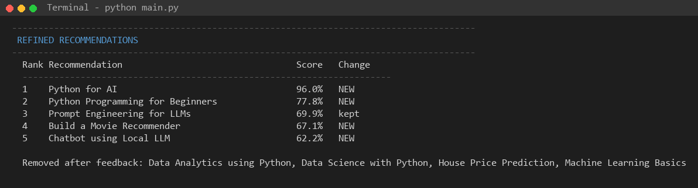
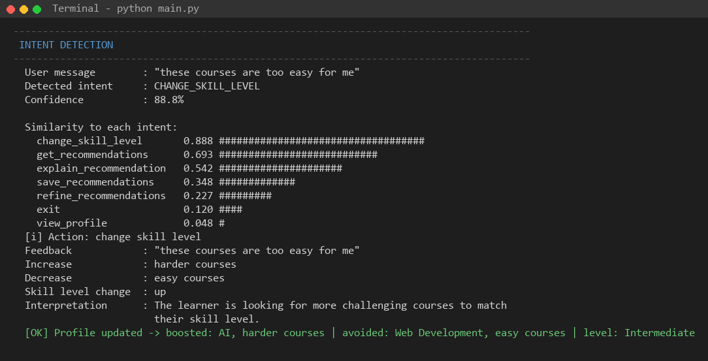
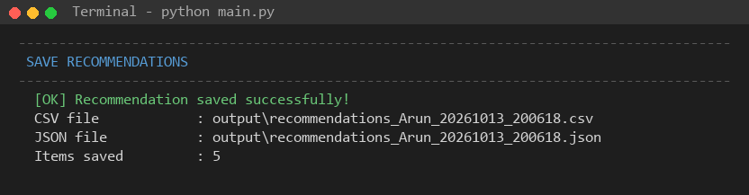

# Personalized Recommendation System using GPT-4

**24CS2506 – Building Applications using GPT-4 · Experiment 4**
Register No: URK23CS1074

A console application that collects a learner's profile, analyses their preferences, and uses a large language model to generate, rank and explain personalized learning recommendations (courses, projects, books, certifications). Users can give feedback in plain English and the system refines the list. A free-text chat option detects the user's intent and routes it to the right action.

The lab specifies GPT-4 served through **Ollama**, so the LLM role is filled by a local model (`llama3.2` by default). Any Ollama model can be swapped in via an environment variable.



## How it works

1. **Input / Profile**: name, age, background, interests, skill level, preferred category, goal, preferences and number of items are read, validated, and turned into a `UserProfile`.
2. **Preference analysis**: the profile is embedded with Sentence Transformers (`all-MiniLM-L6-v2`) and matched against a 48-item catalog loaded with Pandas. Level, format and liked-topic boosts are applied, disliked topics are filtered out, and the top 15 candidates are retrieved. The LLM also summarises the learner's key interests, learning style and focus areas.
3. **Prompt**: profile, analysis and candidates are assembled into a structured prompt that asks for JSON output.
4. **Recommendation**: the LLM picks the top-N candidates with a reason and confidence for each. IDs are checked against the catalog, so the model cannot recommend items that don't exist.
5. **Ranking**: each item gets a suitability score:
   `0.40 × LLM confidence + 0.35 × semantic similarity + 0.15 × level fit + 0.10 × format fit`
6. **Explanation**: the LLM writes a personalised "why" for each item, alongside the interests it matched.
7. **Feedback**: e.g. *"I am more interested in AI than Web Development."* The LLM pulls out topics to boost and to avoid, the profile is updated, and the pipeline re-runs. The refined list marks items as NEW or kept and lists the ones removed.
8. **Intent detection**: free-text messages are classified into `get_recommendations`, `refine_recommendations`, `explain_recommendation`, `change_skill_level`, `save_recommendations`, `view_profile` or `exit` by embedding similarity to example phrases.
9. **Save**: results are written to `output/*.csv` and `output/*.json`, together with the profile and feedback history.

## Modules

| Module | File | Responsibility |
|---|---|---|
| Input | `recommender/input_module.py` | Reads and validates user details from the console |
| Profile | `recommender/profile_module.py` | Builds and displays the structured `UserProfile` |
| Preference | `recommender/preference_module.py` | Semantic catalog retrieval, domain affinity, LLM preference analysis |
| Prompt | `recommender/prompt_module.py` | Builds the structured system and user prompt |
| Recommendation | `recommender/recommendation_module.py` | Calls the LLM and validates its JSON recommendations |
| Ranking | `recommender/ranking_module.py` | Computes the weighted suitability score and ranks items |
| Explanation | `recommender/explanation_module.py` | Generates personalised explanations and matched interests |
| Feedback | `recommender/feedback_module.py` | Interprets feedback, updates the profile, compares lists |
| Intent | `recommender/intent_module.py` | Embedding-based intent classification of chat messages |
| Save | `recommender/save_module.py` | Writes recommendations and history to CSV/JSON |
| Main | `main.py` | Menu loop, session state and orchestration |

Shared helpers: `config.py` (settings), `llm_client.py` (Ollama and embedding wrappers), `ui.py` (console formatting).

## Setup

```bash
# 1. Install Ollama (https://ollama.com) and pull a model
ollama pull llama3.2

# 2. Install Python dependencies
pip install -r requirements.txt

# 3. Run
python main.py
```

Optional environment variables:

| Variable | Default | Purpose |
|---|---|---|
| `RECSYS_LLM_MODEL` | `llama3.2` | Ollama model name |
| `RECSYS_EMBED_MODEL` | `all-MiniLM-L6-v2` | Sentence-Transformers model |

## Menu

```
 1. Enter user profile          7. Explain recommendations
 2. View collected profile      8. Give feedback and refine
 3. Analyse preferences         9. Chat with the assistant (intent detection)
 4. Generate prompt            10. Save recommendations
 5. Get GPT-4 recommendations  11. Run full pipeline (3 -> 7)
 6. Rank recommendations        0. Exit
```

Each step runs any earlier step it depends on automatically, so you can jump straight to option 6 or 11 after entering a profile.

## Sample run

| | |
|---|---|
|  |  |
|  |  |
|  |  |
|  |  |

All screenshots are in [`docs/screenshots/`](docs/screenshots/), and a saved result is in [`output/`](output/).

## Tech stack

Python 3.14 · Ollama 0.34 (llama3.2) · Pandas 3.0 · Sentence Transformers 6.1 · VS Code
